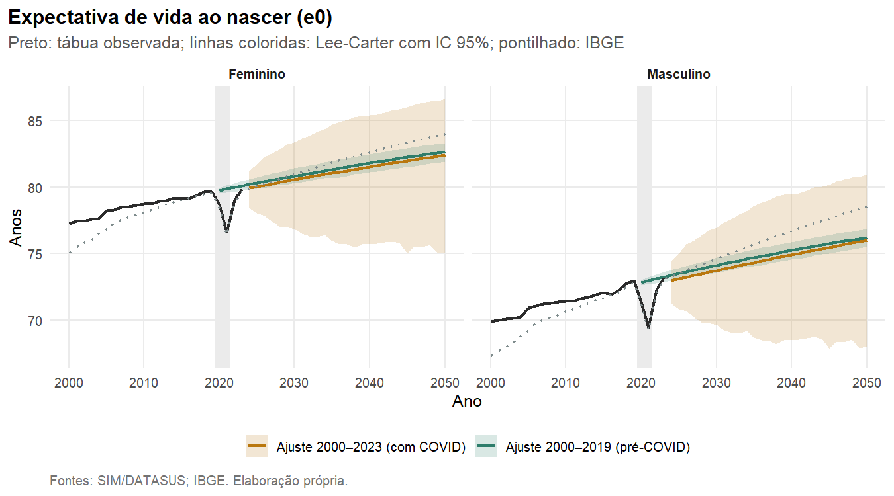

# Tábua de mortalidade brasileira + projeção Lee-Carter

[](https://giulianoxrg.github.io/tabua-mortalidade-brasil/)

[](LICENSE)

Tábuas de mortalidade completas do Brasil (idade simples de 0 a 100+, por
sexo, 2000–2023), construídas **só com dados abertos**, e projeção da
mortalidade até 2050 pelo modelo de **Lee-Carter**, com intervalos de
confiança e análise do efeito da COVID-19.

📄 **Relatório completo:** <https://giulianoxrg.github.io/tabua-mortalidade-brasil/>



## Objetivo

Reproduzir, de ponta a ponta e de forma auditável, o trabalho típico de um
atuário de longevidade:

1. tratar microdados de óbitos (SIM/DATASUS) e estimativas populacionais;
2. construir tábuas de vida por ano e sexo, com tratamento das idades
   avançadas;
3. comparar os resultados com a tábua oficial do IBGE e explicar as
   diferenças;
4. ajustar, projetar e validar (resíduos e *backtesting*) um modelo
   estocástico de mortalidade.

## Principais resultados

| | Homens | Mulheres |
|---|---|---|
| e0 calculada, 2023 | 73,2 anos | 79,8 anos |
| e0 do IBGE, 2023 | 73,1 anos | 79,7 anos |
| e0 projetada, 2050 (ajuste 2000–2019, IC 95%) | 76,2 (75,5–76,9) | 82,7 (81,9–83,3) |
| e65 projetada, 2050 (ajuste 2000–2019) | 18,2 anos | 21,1 anos |
| Erro médio do backtesting de e0 (2015–2019) | 0,23 ano (os dois sexos) | |

* A **cobertura do SIM** subiu de cerca de 85% (2000) para 98% (2019–2023).
  Por isso, a e0 calculada superava a oficial em mais de 2 anos em 2000, mas
  fica a 0,1–0,2 ano dela em 2023.
* Essa mesma melhora do registro **esconde parte da queda da mortalidade**,
  e o Lee-Carter projeta e0 abaixo do IBGE em 2050.
* Incluir 2020–2021 no ajuste **quase não altera a tendência central**, mas
  multiplica a largura dos intervalos de confiança.

## Metodologia (resumo)

| Etapa | Método |
|---|---|
| Ignorados | Idade e sexo ignorados redistribuídos proporcionalmente, dentro de cada ano |
| Taxas | $m_x = D_x / E_x$, com $E_x$ = população em 1º de julho |
| Idades 80+ | Modelo de **Kannisto** ajustado por Poisson em 80–89, validado fora da amostra com o Censo 2022 |
| Grupo 90+ da população | Aberto em 90, …, 100+ pela população estacionária do Kannisto |
| $a_x$ | Coale-Demeny em $a_0$; força exponencial em $a_1$; 0,5 nas demais idades |
| Tábua | $q_x$, $l_x$ (raiz 100.000), $d_x$, $L_x$, $T_x$, $e_x$, fechada em 100+ |
| Lee-Carter | `StMoMo::lc()`, Poisson com link log, idades 0–100, por sexo |
| Projeção | $k_t$ por ARIMA(0,1,0) com drift; 1.000 simulações para IC de e0 e e65 |
| Cenários | Ajuste 2000–2019 (pré-COVID) e 2000–2023 (com COVID) |
| Validação | Resíduos de deviance (idade × ano) e *backtesting* (ajuste 2000–2014, teste 2015–2019) |

Os detalhes e as fórmulas estão no [relatório](https://giulianoxrg.github.io/tabua-mortalidade-brasil/).

## Fontes de dados

| Dado | Fonte | Acesso |
|---|---|---|
| Óbitos 2000–2023 | Ministério da Saúde, **SIM/DATASUS** (declarações de óbito, todas as UFs) | `microdatasus::fetch_datasus(information_system = "SIM-DO")` |
| População por sexo e idade simples (0–89, 90+) | **IBGE, Projeções da População, Revisão 2024**, Tabela 1 | [FTP do IBGE](https://ftp.ibge.gov.br/Projecao_da_Populacao/Projecao_da_Populacao_2024/) (`projecoes_2024_tab1_idade_simples.xlsx`) |
| e0, e60 e óbitos oficiais | IBGE, Projeções da População, Revisão 2024, Tabela 4 | `projecoes_2024_tab4_indicadores.xlsx` |
| População 90–100+ | **IBGE, Censo Demográfico 2022**, SIDRA tabela 9514 | [API SIDRA](https://apisidra.ibge.gov.br/) |
| Checagem da população | Pacote `brpop` (grupos quinquenais) | CRAN |

> **Nota sobre o `brpop`:** o pacote só oferece a população em grupos
> quinquenais até 80+. Por isso, a fonte principal é a projeção do IBGE em
> idade simples, e o `brpop` serve de checagem (diferença ≤ 1,6% no total).

Todos os dados são baixados automaticamente pelo pipeline. Os brutos ficam
em `data/raw/` (fora do Git) e os tratados, em `data/processed/` (parquet).

## Como reproduzir

Requisitos: R ≥ 4.3 e [Quarto](https://quarto.org) (já incluso no RStudio).

```r
# 1. Instalar as versões exatas dos pacotes
renv::restore()

# 2. Rodar o pipeline completo (download, tábuas, Lee-Carter e relatório)
targets::tar_make()
```

* O primeiro `tar_make()` baixa cerca de 650 arquivos do DATASUS e leva
  **cerca de 1h30**. As execuções seguintes só refazem o que mudou.
* Fora do RStudio, informe onde está o Quarto, por exemplo
  `Sys.setenv(QUARTO_PATH = "C:/Program Files/RStudio/resources/app/bin/quarto/bin/quarto.exe")`.
* Para visualizar o grafo de dependências: `targets::tar_visnetwork()`.
* Testes: `source("tests/testthat.R")`.

## Estrutura

```
.
├── _targets.R              # pipeline (targets)
├── R/
│   ├── config.R            # parâmetros globais (anos, idades, cenários)
│   ├── dados_obitos.R      # download e tratamento do SIM
│   ├── dados_populacao.R   # IBGE (projeções e Censo 2022) e brpop
│   ├── dados_processados.R # parquet, marcação da COVID, cobertura
│   ├── velhice.R           # Kannisto/Gompertz e abertura do grupo 90+
│   ├── tabua.R             # life_table() e construção das tábuas
│   ├── lee_carter.R        # fit_lc(), projeção, resíduos, backtesting
│   ├── graficos_*.R        # gráficos (tema e paleta em tema.R)
│   └── tema.R
├── data/
│   ├── raw/                # dados brutos (não versionados)
│   └── processed/          # tábuas, taxas e projeções em parquet
├── output/figures/         # gráficos
├── report/relatorio.qmd    # relatório Quarto
├── docs/index.html         # relatório publicado (GitHub Pages)
├── tests/testthat/         # testes unitários
└── renv.lock
```

## Principais saídas (`data/processed/`)

| Arquivo | Conteúdo |
|---|---|
| `tabuas_mortalidade.parquet` | Tábuas completas: ano, sexo, idade, mx, ax, qx, lx, dx, Lx, Tx, ex |
| `mx_exposicao.parquet` | Óbitos, exposição, mx observado e suavizado |
| `comparacao_e0_ibge.parquet` | e0 e e60 calculadas × IBGE |
| `lc_projecao_e0_e65.parquet` | e0 e e65 projetadas até 2050, com intervalos |
| `lc_kt.parquet`, `lc_ax_bx.parquet` | Parâmetros do Lee-Carter |
| `lc_backtest.parquet` | Resultado do backtesting |

## Limitações

As tábuas são de **população geral, sem correção do sub-registro** de
óbitos. Não substituem tábuas oficiais nem tábuas de experiência de
carteira. O Lee-Carter considera só a incerteza de $k_t$, e por isso seus
intervalos são estreitos. A discussão completa está no relatório.

## Licença

[MIT](LICENSE) © 2026 GiulianoXRG
